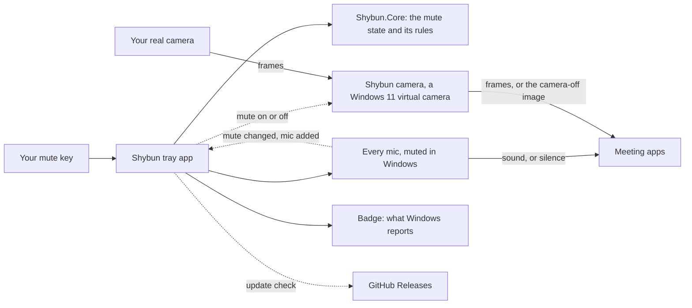

<h1 align="center">
  <picture>
    <source media="(prefers-color-scheme: dark)" srcset="docs/brand/lockup-dark.svg">
    
  </picture>
</h1>

**One key mutes your mic and camera, in every app.** A badge shows you're muted, and it only says so when Windows confirms it.

Windows has no camera key, and its own mic key (Win+Alt+K) works only in apps that support it. PowerToys' Video Conference Mute did both, until [v0.88.0 removed it](https://github.com/microsoft/PowerToys/pull/36772) in January 2025. People still keep PowerToys at 0.87.1 to hold on to it ([PowerToys #38604](https://github.com/microsoft/PowerToys/issues/38604)).

> **Status:** in development. The mic half, the badge and the Shybun camera, installed from the tray menu, work when built from source; the camera's badge and a release come next. See [ROADMAP.md](ROADMAP.md). Until Shybun ships, use one of the tools under [Alternatives](#alternatives).

## Before and after

| You're… | Without Shybun | With Shybun |
|---|---|---|
| on a Teams call when someone walks in | you find Teams' window, then its mute and camera buttons | one key from whatever app you're in, and both go quiet |
| in a Meet tab behind your editor | Meet's shortcuts work only while its tab has focus | the key works from your editor, and Meet stays behind it |
| unsure whether you're muted | you check each app, or ask "can you hear me?" | the badge shows what Windows reports for the mic and the camera |
| plugging in a headset while muted | the headset's mic is live | a mic that appears while you're muted is muted on arrival |
| joining a call in an app that turns the camera on | your camera is live before you find the button | the app gets the camera-off image until you unmute |

The Meet row comes from a comment on [PowerToys #38604](https://github.com/microsoft/PowerToys/issues/38604): browser meetings can't hear a shortcut while they're in the background.

## What it does

Planned for 1.0:

- **One key for both.** It mutes every mic Windows has and the Shybun camera, from any app, without moving focus.
- **A badge you can trust.** A small always-on-top badge shows the mic's and the camera's state as Windows reports it, read back after every change. When Shybun can't confirm a device is quiet, the badge says so instead of guessing.
- **New mics join muted.** A headset plugged in while you're muted is muted the moment it appears.
- **The Shybun camera.** Pick it once in each meeting app, where Windows lists it as "Shybun camera (Windows Virtual Camera)". It passes your camera through, and sends a camera-off image while you're muted. It needs Windows 11, and admin once to install. Without admin, Shybun can't turn the camera off, but the badge still shows when an app has it on.
- **Installs signed, through winget, and updates itself.** A tick in the tray menu turns updates off.

The mic half mutes the device in Windows, so a meeting app's own mute icon doesn't change. Trust the badge, not the app.

## The trust contract

Shybun sits between you and your mic and camera, so it has to be easy to trust.

- **Nothing injected.** Shybun never pushes code into another app. The Shybun camera is the one part other processes load, and Windows does the loading, as it does for any camera's software. It passes frames through and swaps in the camera-off image, nothing else.
- **No network, except the update check.** Shybun asks GitHub Releases for a newer version of itself, and that's all. There's no telemetry, and the Shybun camera never touches the network. A tick in the tray menu turns the check off.
- **Nothing recorded.** No frame or sound is ever stored or sent. The mic half never listens at all: it only flips Windows' mute switch.
- **Runs unelevated.** The mic half never needs admin. The Shybun camera needs it once, at install, because Windows only accepts a camera source that's registered for the whole machine.
- **Open source,** so you can check all of this instead of trusting it.

## How it works

## Alternatives

Checked against each one's own docs on 2026-10-24.

| | Shybun (planned) | [eitchtee/VCM](https://github.com/eitchtee/VCM) 1.1.1 | [PowerToys VCM](https://github.com/MicrosoftDocs/windows-dev-docs/blob/545ae49baae21d722fa67626283c755331238b81/hub/powertoys/video-conference-mute.md) 0.87.1 | [MuteDeck](https://mutedeck.com) | [AHK_MicMute](https://github.com/SaifAqqad/AHK_MicMute) 1.3.4 |
|---|---|---|---|---|---|
| Mic | every mic, muted in Windows | the default mic | every mic, or the one you pick | each meeting app's own mute button | the mics you pick |
| Camera | a virtual camera you pick once in each app | a virtual camera you pick in each app | a virtual camera you pick in each app | each meeting app's own camera button | none |
| Shows your state | a badge, from what Windows reports | an on-screen display while muted | a toolbar | its own app | an overlay |
| Install | admin once, for the camera | admin, to register its camera | with PowerToys, plus a camera driver | an app, plus a browser extension for web meetings | none: a portable exe, or Scoop |
| Status | planning | active, no license file | removed in v0.88.0, so no fixes | paid once per computer, 7-day trial | free (Unlicense), last release 2025-11-19 |

**Pick eitchtee/VCM today** if you want both halves now: it does what Shybun plans, and Shybun has no release. **Pick MuteDeck** if you'd rather your meeting app's own mute icon stays right, or don't want to pick another camera in each app; it also runs on macOS. **Pick AHK_MicMute** if you only need the mic: it's mature, with push-to-talk, profiles per app and an overlay. Windows' own Win+Alt+K mutes the mic "in supported apps", and Windows has no camera key.

## Contributing

Issues are welcome. Planning lives in [ROADMAP.md](ROADMAP.md).

## License

[Apache-2.0](LICENSE). Shiori, the shy homebody in this README, was drawn with an AI image model and is Apache-2.0 like the code.
