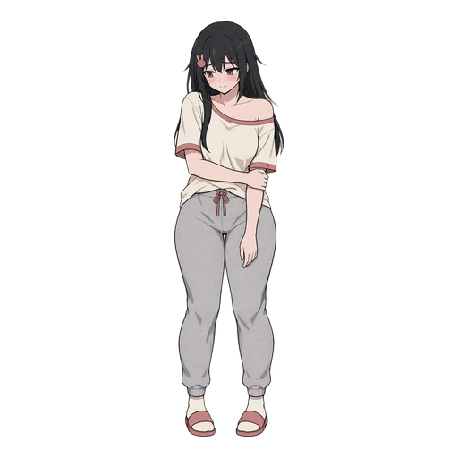

# Shybun brand

The logo is a placeholder: a shy bunny with its eyes closed and its cheeks blushing, as Shybun closes the camera and quiets the mic. The real logo is an owner item in M0 of the [roadmap](../../ROADMAP.md), to be picked in a claude.ai design project. The mascot is [Shiori](#shiori).

- `mark.svg` / `mark-dark.svg`: the bunny mark, for light and dark backgrounds.
- `lockup.svg` / `lockup-dark.svg`: the mark plus the "shybun" wordmark, as in the README's title.
- The wordmark is Fredoka SemiBold (SIL Open Font License), lowercase, with -0.01em letter spacing, converted to paths because GitHub can't load web fonts inside SVGs. It's the same face as Staypaw's and Sweepling's. Use the SVGs; don't re-typeset it. `scripts/make_lockup.py` rebuilds both lockups from the font and the mark, and its header says how. Rerun it whenever the mark changes.
- `app-icon.svg` is the mark on a paper tile, with thicker lines for small sizes. It's the source of `shybun.ico` and `app-icon-256.png`, which `scripts/make-icons.cs` renders.

Logo colours: ink `#1d1a16` and blush `#c4567a` on light backgrounds, paper `#f2ede2` and blush `#f08fb0` on dark ones.

## Shiori

Shiori Burrows is a shy homebody who would rather stay unseen and unheard, and blushes the moment anyone notices her. She is the app's line as a person: a shy bunny hides its face and goes quiet, as Shybun turns off the camera and the mic. Her bunny-head hair clip is her one bunny cue, and the one shape that holds at small sizes. She is the face of the README and launch posts; the bunny mark stays the logo and the app icon.

| File | Shows | Means |
|---|---|---|
| `shiori/base.png` | Full body, holding one arm | Her reference |
| `shiori/hidden-and-quiet.png` | One hand over her eyes, one over her mouth, one eye peeking | Muted: the camera and the mic together, the one-key state |
| `shiori/back-on.png` | A small shy wave, and she looks at you | Live again |
| `shiori/not-sure.png` | Touching her clip, with a wavy mouth and a sweat drop | The badge's unconfirmed state, and "am I muted?" |
| `shiori/bunny-pajamas.png` | Bunny pajamas, hood up | Off hours |

- The PNGs are 512 px square with transparent backgrounds. The stickers have a white die-cut border; `base.png` and `bunny-pajamas.png` have none.
- Her colours, sampled from `shiori/base.png`: hair `#38363A`, skin `#F2D7CE`, tee `#F0E7DC`, joggers `#BCB8B9`, and dusty rose `#C08182` on her clip, the tee's bands, the drawstrings and the slides. Her rose is not the logo's blush, on purpose: the two stay apart until the real logo is picked. None of them is a text colour.
- Her art is AI-generated with OpenAI's gpt-image-2.5-flare, from a written character spec, and like the code it is Apache-2.0. Don't edit or redraw her here; new stickers come from the same spec, so the set stays consistent.

 
